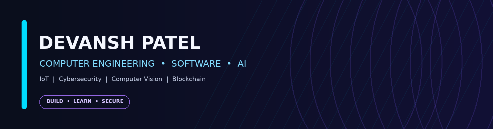

  

<h1 align="center">Hey, I'm Devansh Patel 👋</h1>

  <strong>Final-Year Computer Engineering Student</strong> 
  IoT • Cybersecurity • Blockchain • AI & Computer Vision

  
  

---

## 👨‍💻 About Me

I'm a final-year **B.E. Computer Engineering** student at Lokmanya Tilak College of Engineering, Mumbai University, specializing in **IoT, Cybersecurity, and Blockchain Technology**. I enjoy building practical software that combines AI, computer vision, web development, and security.

- 🔭 Building AI‑powered applications, computer vision projects, and full‑stack web solutions.
- 🧠 Exploring deep learning, OpenCV, MediaPipe, and Edge AI.
- 🛡️ Interested in cybersecurity analysis, networking, and secure system design.
- 🌱 Always learning new tools and turning ideas into working projects.
- 🎓 Expected graduation: **2027**.

---

## 🛠️ Tech Stack

### Languages

  
  
  
  
  
  
  

### AI, Machine Learning & Computer Vision

  
  
  
  

### Web Development & Tools

  
  
  
  
  
  
  
  

### Core Interests
`IoT` · `Cybersecurity` · `Blockchain` · `Networking` · `Computer Vision` · `Edge AI`

---

## 🚀 Featured Projects

### 🧠 Hybrid Deepfake Detection System
An AI-powered deepfake detection application combining **ResNet18, PyTorch, OpenCV, and MediaPipe**. Includes real-time detection, automated analysis reports, and confidence visualization.

- **Tech:** Python, Streamlit, PyTorch, OpenCV, MediaPipe
- **Evaluation:** Accuracy, Precision, Recall, F1-Score, ROC-AUC, and Confusion Matrix
- **Project repo:** [Hybrid Deepfake Detection](https://github.com/DHP065/Hybrid-Deepfake-Detection)

### 🅿️ Smart Parking Management System
An AI-powered parking solution integrating Edge AI, computer vision, and cloud computing to support parking-space detection and management.

- **Features:** CCTV-based parking detection, QR authentication, geo-fenced reservations, cloud synchronization, and a responsive monitoring dashboard
- **Tech:** Edge AI, Computer Vision, Cloud Computing

### 🛡️ Cybersecurity File Analysis System
A browser-based static malware analysis tool that extracts file metadata, performs entropy analysis, and calculates heuristic threat scores.

- **Features:** Supports multiple file formats and categorizes risk as Low, Medium, High, or Critical
- **Tech:** JavaScript

### 🎮 Arcadia — Interactive PC Gaming Platform
A responsive gaming platform with game discovery, REST API integration, search and filtering, wishlist management, a user dashboard, and purchase workflow.

- **Features:** Theme switching, trailer galleries, and offline caching with LocalStorage
- **Tech:** HTML, CSS, JavaScript

---

## 📜 Certifications

- **Data Structures and Algorithms** — Coursera (2026)
- **Foundation Course on Green Skills and Artificial Intelligence** — Skills4Future (2025)
- **Excel Skills Job Simulation** — Forage (2024)

---

## 🤝 Leadership & Activities

- 🎨 **Design Co-Head** — ISTE
- 🧩 **Creative Team Member** — CSESA
- 🎪 Helped organize and run **7+ campus-wide events**.
- 🎓 Assisted the Training & Placement Office with placement activities.

---

## 📊 GitHub Stats

  
  

---

## 📫 Let's Connect

- **Email:** [devansh655patel@gmail.com](mailto:devansh655patel@gmail.com)
- **GitHub:** [github.com/DHP065](https://github.com/DHP065)

<i>“Build with curiosity. Secure with purpose. Improve every day.”</i>

